# CI/CD Pipeline — Fully Explained (Jenkins → GitHub Actions)

This document explains, in plain words **and with diagrams**, what our CI/CD
pipeline does, why each part exists, and how the new GitHub Actions version
works. It replaces the old Jenkins pipeline (see `Jenkinsfile` in the repo
root) **without changing behavior**.

**Reading tip:** every chart below is written in "mermaid" syntax. On GitHub
they render automatically. In VS Code, install the *Markdown Preview Mermaid*
extension and press `Ctrl+Shift+V` to see them.

---

## Table of contents

1. [What is this project? (big picture)](#1-what-is-this-project-big-picture)
2. [Glossary — words you will see often](#2-glossary--words-you-will-see-often)
3. [The big picture diagram](#3-the-big-picture-diagram)
4. [The 4 stages in detail](#4-the-4-stages-in-detail)
5. [Main pipeline flow (full chart)](#5-main-pipeline-flow-full-chart)
6. [Project-type detection](#6-project-type-detection)
7. [Deploy protection layers (defense in depth)](#7-deploy-protection-layers-defense-in-depth)
8. [Backup & rotation explained with diagrams](#8-backup--rotation-explained-with-diagrams)
9. [rsync + exclude list explained with diagrams](#9-rsync--exclude-list-explained-with-diagrams)
10. [Health check & rollback explained with diagrams](#10-health-check--rollback-explained-with-diagrams)
11. [Safety rules (Layer 5) explained with diagrams](#11-safety-rules-layer-5-explained-with-diagrams)
12. [Testing the risky parts without a real server (self-test)](#12-testing-the-risky-parts-without-a-real-server-self-test)
13. [Secrets and Variables](#13-secrets-and-variables)
14. [Jenkins → GitHub Actions cheat sheet](#14-jenkins--github-actions-cheat-sheet)
15. [Open questions / TODO before the first real deploy](#15-open-questions--todo-before-the-first-real-deploy)
16. [How to verify a run](#16-how-to-verify-a-run)

---

## 1. What is this project? (big picture)

We are replacing **Jenkins** with **GitHub Actions**.

- **Jenkins** is software that needs its own server (rented or bought) running
  24/7. That costs money and needs maintenance (updates, backups, security).
- **GitHub Actions** runs on **GitHub's own computers** ("runners"),
  automatically, whenever code is pushed. Free for small projects. No server
  to maintain.

**Goal:** when code is pushed (or merged) to the `main` branch, GitHub
automatically:

1. downloads the code (**Checkout**),
2. builds it (**Build**),
3. tests it (**Test**),
4. copies it to our shared-hosting cPanel server over SSH (**Deploy**).

If any step fails, the deploy never happens (or is **rolled back**
automatically), and the live website stays safe.

### CI vs CD — the two halves

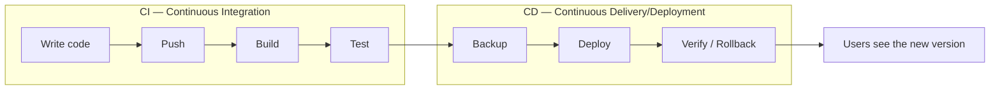

- **CI** = *did the code build and pass tests?* Runs on **every** push and PR.
- **CD** = *put the verified code on the server.* Runs **only** on `main`.

---

## 2. Glossary — words you will see often

| Word | Plain meaning |
|------|---------------|
| **Workflow** | A YAML file in `.github/workflows/` that tells GitHub what to do and when. |
| **Job** | One unit of work inside a workflow (e.g. `build`, `deploy`). Jobs run on separate runners; a job can depend on another (`needs:`). |
| **Step** | One command inside a job (e.g. `npm ci`). Steps run one after another in the same job. |
| **Runner** | The temporary computer GitHub gives us for a run. Destroyed afterwards. `ubuntu-latest` = a Linux VM. |
| **SSH** | Secure Shell — encrypted remote login, like sitting at the server's keyboard. Uses a **key pair**: private key stays secret (our "password"), public key sits on the server (the "lock"). |
| **rsync** | A copy tool that only transfers changed files and can delete files on the destination that no longer exist locally (`--delete`). |
| **cPanel** | The hosting control panel BigRock gives us. `public_html/` is the web-visible folder. |
| **Environment** | A GitHub feature: a named deployment target (`demo`, `production`) that can require a human to click *Approve* before a deploy continues. |
| **Concurrency group** | A "one lane" queue: only one run per group at a time. The other runs wait. |
| **Rollback** | Restoring the previous version from a backup after a bad deploy. |
| **Canary file** | In the self-test: a secret marker file used to prove rollback really restored everything. |

---

## 3. The big picture diagram

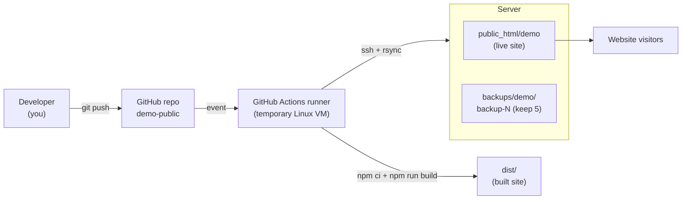

**What happens, step by step:**

1. You run `git push`. GitHub receives the new commit.
2. GitHub sees a rule in our workflow file: "on push to `main`, run the
   pipeline". It starts a **run**.
3. GitHub starts a **runner** — a clean virtual machine that exists only for
   this run.
4. The runner downloads the code, installs dependencies, builds `dist/`,
   runs the tests.
5. If everything passed **and** this is a push to `main`, the runner opens an
   SSH connection to the BigRock server and copies `dist/` into
   `public_html/demo` with rsync.
6. The runner checks the site is alive. If not, it restores the backup.
7. The runner is destroyed. Visitors now see the new version.

---

## 4. The 4 stages in detail

### 4.1 Stage map

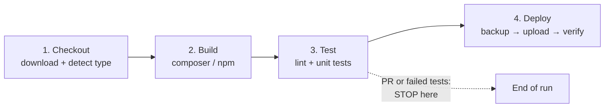

### 4.2 Checkout

| Topic | Detail |
|-------|--------|
| **What** | `actions/checkout` downloads the exact commit that triggered the run onto the runner. |
| **Also** | A detection step checks which files exist (`composer.json`, `package.json`, `*.html`) to decide the *project type* — this drives every later step. |
| **Fails if** | The repo has none of the known file types (unknown project). |

### 4.3 Build

| Project type | Build commands | Result |
|--------------|----------------|--------|
| **PHP** (`composer.json` exists) | `composer install --no-interaction --prefer-dist` | `vendor/` folder with dependencies |
| **Node** (`package.json` exists) | `npm ci` (or `npm install` if no lock file) → `npm run build --if-present` | `dist/` folder with the built site |
| **Static** (only `.html` files) | nothing | files as-is |
| **C++** (CMake/Make — build & test only, never deployed) | `cmake` / `make` | binaries (not uploaded) |

For **this** repo (`demo-public`) the type is **Node**, so the interesting
part is `npm ci` + `vite build` → `dist/`.

### 4.4 Test

| Project type | Test commands | Then |
|--------------|---------------|------|
| **PHP** | `php -l` on every `*.php` outside `vendor/` (syntax check) → `vendor/bin/phpunit` if present | `composer install --no-dev` — strips dev tools so only production code gets uploaded |
| **Node** | `npm run lint --if-present` → `npm test --if-present` | — |
| **Static** | none | — |

**Golden rule:** a red test **stops the pipeline before Deploy**. Broken code
can never reach the server.

### 4.5 Deploy (only on push to `main`)

Sub-steps (each explained in its own section below):

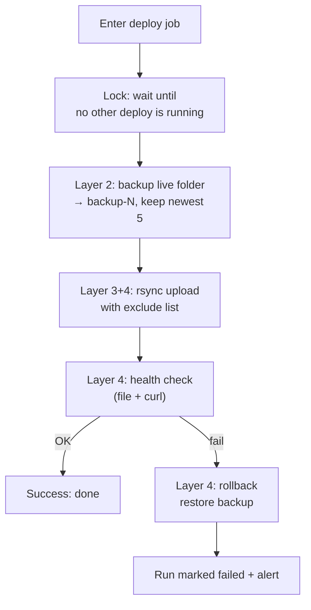

---

## 5. Main pipeline flow (full chart)

This is the **complete** decision flow of the whole pipeline:

```mermaid
flowchart TD
    A["Push or PR to GitHub"] --> B{"Event type?"}
    B -- "Pull request" --> C["BUILD + TEST only<br>🚫 never touches the server"]
    B -- "Push to main" --> C2["BUILD + TEST"]
    C --> D{"Tests passed?"}
    C2 --> D
    D -- "No" --> E["❌ Stop. Mark run failed.<br>Alert step (echo for now)."]
    D -- "Yes" --> F{"Project type?"}
    F -- "Node + dist/index.html exists" --> G["Deploy folder = dist/"]
    F -- "PHP or static" --> G3{"index.html or<br>index.php exists?"}
    F -- "C++" --> NC["Built & tested.<br>Nothing is deployed."]
    G3 -- "Yes" --> G3B["Deploy folder = repo root"]
    G3 -- "No" --> E
    G --> H
    G3B --> H
    H["Concurrency: wait for a free<br>deploy slot (one at a time per APP_NAME)"]
    H --> I["Layer 2: Backup live folder<br>→ backup-&#60;run&#62;, keep newest 5"]
    I --> J["Layer 3: rsync -az --delete<br>with exclude list + SERVER_ONLY"]
    J --> K{"Layer 4: Health check<br>1) entry file exists on server?<br>2) curl SITE_URL (if set, with retries)?"}
    K -- "Yes" --> L["✅ Done — success.<br>version.txt notes run + commit."]
    K -- "No" --> M["Layer 4: Rollback<br>rsync backup → live folder"]
    M --> E
```

**Reading the chart:**

- Left path (PR): feedback only, zero risk.
- Middle path (push to `main`): full pipeline including deploy.
- Any red box: the run ends **failed** — humans look at it. The live site is
  either untouched or already rolled back.

---

## 6. Project-type detection

One workflow file must serve **many** repos (today: two Vite demos; tomorrow:
PHP company projects). So the pipeline *detects* what it is dealing with:

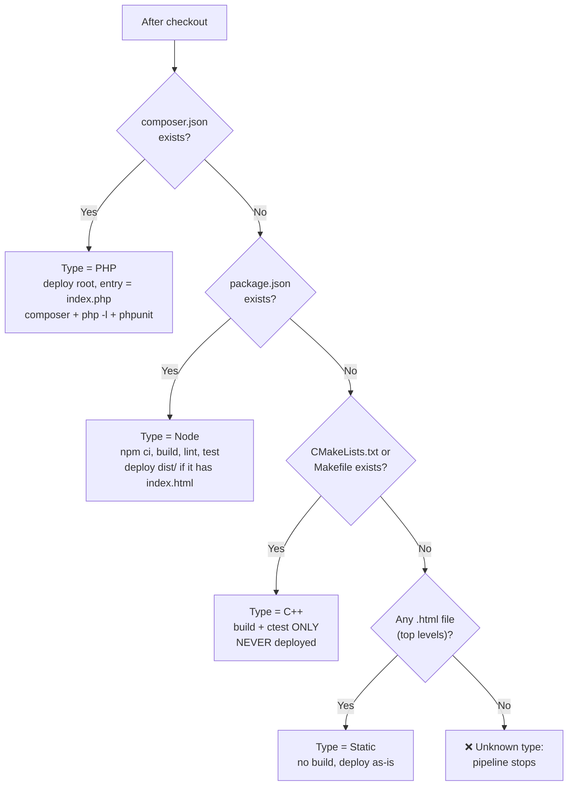

**First match wins** (same order as the original Jenkinsfile). For
`demo-public` the answer is **Node**, and after `vite build` the deploy
folder is `dist/` because `dist/index.html` exists.

**Guard before deploy:** even when the type is known, the pipeline refuses to
deploy if the upload folder contains **neither** `index.html` **nor**
`index.php`. This matters because rsync uses `--delete` — uploading an empty
folder would wipe the live site. Better to fail loudly than to delete a
website by accident.

---

## 7. Deploy protection layers (defense in depth)

"Defense in depth" = several independent safety nets, so one failure alone
cannot destroy the site.

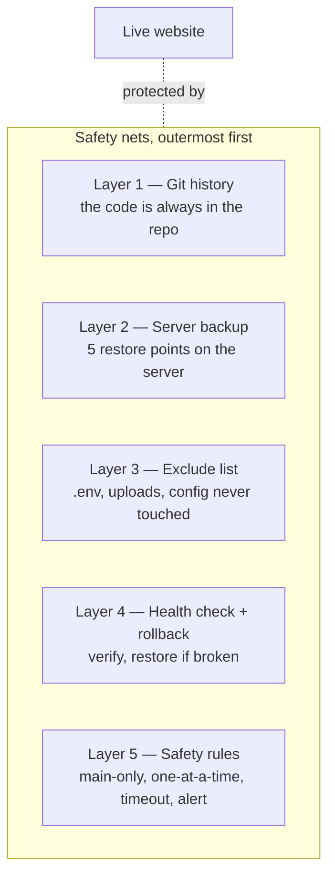

### Layer 1 — Git history (the base recovery path)

The code is always in the repository. Worst case: `git revert` or re-deploy
any old commit. Nothing that ever reached production is "lost" — it is all in
git. This is the foundation; everything else is convenience and speed.

### Layer 2 — Backup before deploy

Before uploading anything, the **live folder is copied on the server** to a
backup folder located **outside** the web root (so backups are never served to
visitors):

```
cp -a <REMOTE_DIR>  <BACKUP_DIR>/backup-<run number>
```

- Only the **newest 5** backups are kept; older ones are deleted.
- Think of it as a "save game" before a boss fight — see section 8 for the
  full picture.

### Layer 3 — Exclude list (never touch server-only files)

The upload uses `rsync --delete` (files missing from the upload get deleted on
the server). To protect files that **only exist on the server**, an exclude
list is used. Excluded files are **never uploaded and never deleted**:

- **Always excluded:** `.git/`, `.github/`, `.gitignore`, CI/build files,
  `node_modules/`, `tests/`, `tmp/`, `.env`, `.env.*`.
- **Per-repo extras** via the `SERVER_ONLY` variable (one path per line), e.g.
  `uploads/`, `config.php`, `images/` — anything the server needs that must
  survive every deploy.

See section 9 for a visual explanation.

### Layer 4 — Health check + automatic rollback

After the upload, two checks run **on the server side**:

1. **Remote file check:** `test -f` for the entry file (`index.html` or
   `index.php`) inside the live folder.
2. **Site check (optional):** `curl` against `SITE_URL` with a few retries —
   proves the web server actually serves the page.

If **either** check fails → **rollback**: the latest backup is rsynced back
over the live folder (same exclude list), restoring the previous state, and
the run is marked **failed** so humans notice. See section 10 for diagrams.

### Layer 5 — Safety rules

| Rule | Why it exists |
|------|---------------|
| Only pushes to `main` deploy | Feature branches and PRs can never touch the server. |
| PRs only build and test | Fast feedback with zero risk. |
| One deploy at a time per app (`concurrency` group, `cancel-in-progress: false`) | A running deploy is **never cancelled halfway** — half-deployed sites are the classic outage cause. A second deploy simply waits. |
| Job `timeout-minutes` | A hung job cannot block the queue forever. |
| Failure alert step (`echo` for now) | Placeholder until we know if alerts go to Slack, email, etc. |

See section 11 for the concurrency diagrams.

---

## 8. Backup & rotation explained with diagrams

### What happens on the server

```mermaid
flowchart TD
    subgraph Before["Before deploy"]
        Live1["public_html/demo<br>OLD version"] --- B1["backups/demo/backup-7"]
    end
    Live1 -->|cp -a (copy)| NewB["backups/demo/backup-8<br>exact copy of OLD"]
    subgraph After["After backup step"]
        Live1
        NewB
    end
```

### Rotation — keep only the newest 5

Each deploy creates `backup-<run number>`. After copying, the pipeline lists
backup folders **newest first** and deletes everything from the 6th onwards:

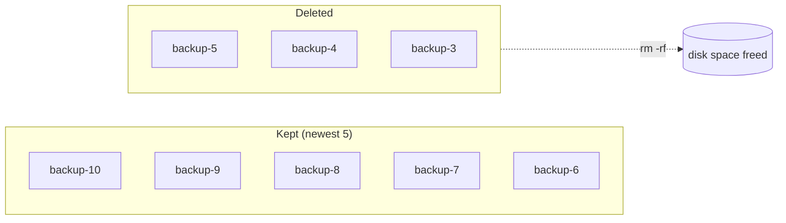

The actual command (same as the Jenkinsfile):

```bash
ls -1dt $BACKUP_DIR/backup-* | tail -n +6 | xargs -r rm -rf
# list backups newest-first → skip the first 5 → delete the rest
```

**Why outside `public_html`?** If backups lived inside the web root, anyone
could download them (`https://site/backups/backup-8.zip`). cPanel accounts
usually have a private folder (e.g. `/home/user/…`) that the web server never
serves — that is where backups go.

---

## 9. rsync + exclude list explained with diagrams

### The upload command

```bash
rsync -az --delete --exclude-from=.rsync-exclude \
      -e "ssh ..."  dist/  user@host:$REMOTE_DIR/
```

| Flag | Meaning |
|------|---------|
| `-a` | archive mode: copy recursively, keep permissions, timestamps, symlinks |
| `-z` | compress during transfer (faster on slow links) |
| `--delete` | remove files on the **server** that are no longer in `dist/` (needed so old, renamed or removed assets disappear) |
| `--exclude-from` | read the exclude list from a file |
| `-e "ssh ..."` | send the data over SSH (encrypted) |
| `dist/` (trailing slash) | copy the **contents** of dist, not the folder itself |

### How `--delete` + excludes work together

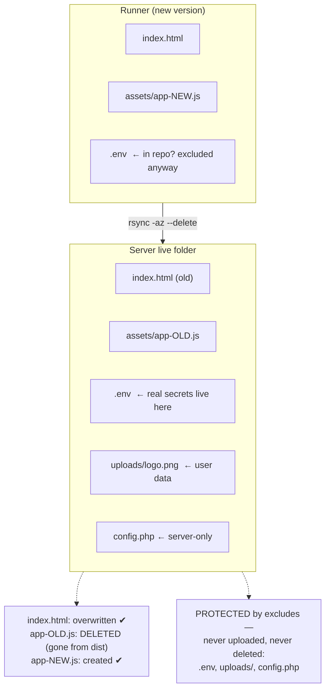

### The exclude file built by the workflow

```
.git/
.github/
.gitignore
Jenkinsfile
.rsync-exclude
.env
.env.*
node_modules/
tests/
tmp/
--- plus everything in the SERVER_ONLY variable ---
uploads/
config.php
```

Mental model: **excluded = invisible to rsync**. It is as if those files do
not exist on either side — so they can neither be overwritten nor deleted.

---

## 10. Health check & rollback explained with diagrams

### Happy path

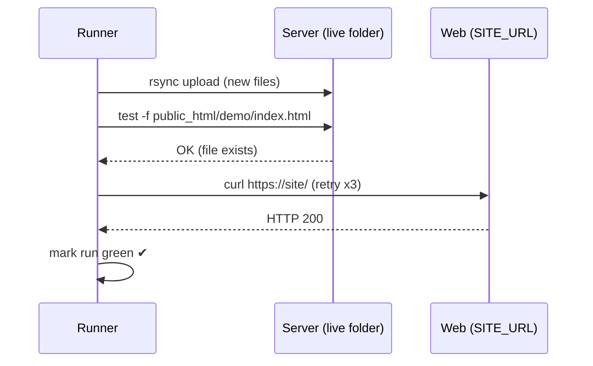

### Sad path → automatic rollback

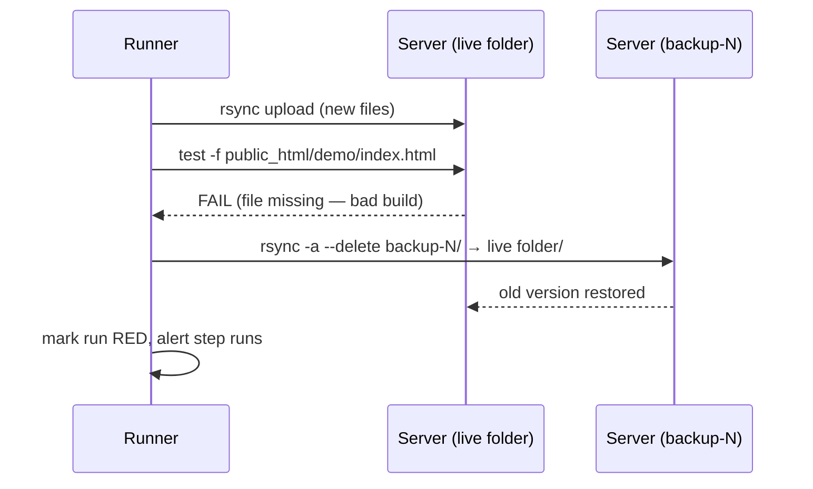

**Key points:**

- The rollback uses the **same exclude list**, so restoring the backup also
  cannot clobber server-only files.
- The run is **still marked failed** — rollback fixes the site, not the build.
  Someone must investigate why the health check failed.
- Rollback happens **inside the concurrency lock**, so no other deploy can
  race with it.

---

## 11. Safety rules (Layer 5) explained with diagrams

### Only `main` deploys; PRs only build/test

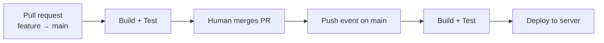

### One deploy at a time (concurrency, never cancel a running deploy)

Each app has its own queue, named after `APP_NAME` — so `demo` and
`demo-private` deploy **independently**, but two pushes to the same app take
turns:

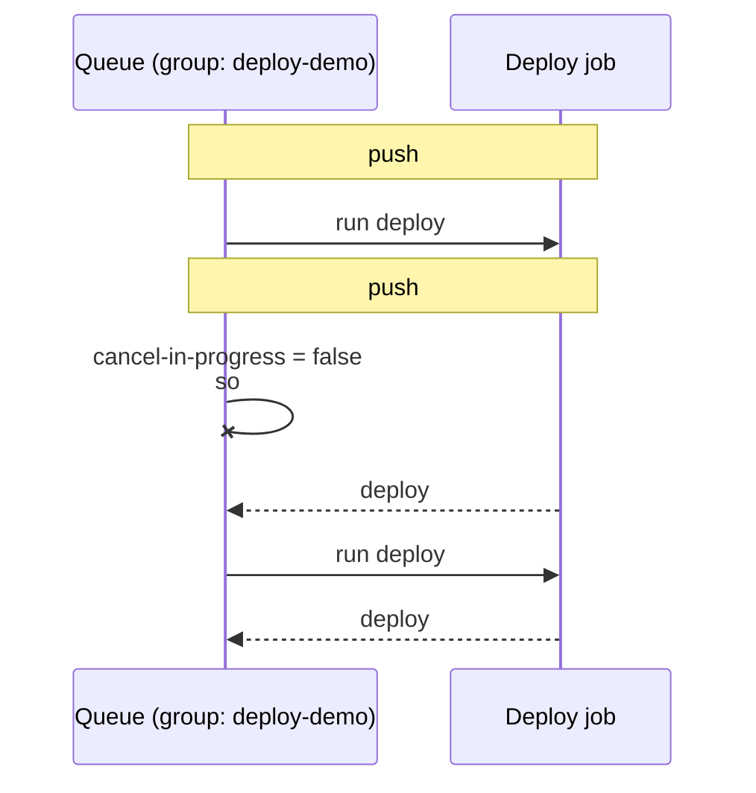

Contrast with `cancel-in-progress: true` (which we deliberately do **not**
use for deploys): that would kill deploy #1 halfway — a half-uploaded site.
Waiting a few extra minutes is much cheaper than an outage.

### Timeout + alert

- Each job has `timeout-minutes` — if SSH hangs, GitHub kills the run and
  frees the queue.
- An `if: failure()` step prints an alert line (placeholder for Slack/email
  once the team decides where alerts should go).

---

## 12. Testing the risky parts without a real server (self-test)

**The problem:** GitHub-hosted runners run in GitHub's cloud. They **cannot**
reach a laptop or an office practice server. BigRock's real credentials are
not available yet. But backup/rsync/rollback is exactly the part most likely
to have bugs — it **must** be tested.

**The solution:** the runner deploys **to itself**. Workflow file:
`.github/workflows/selftest.yml`.

### Setup inside the runner

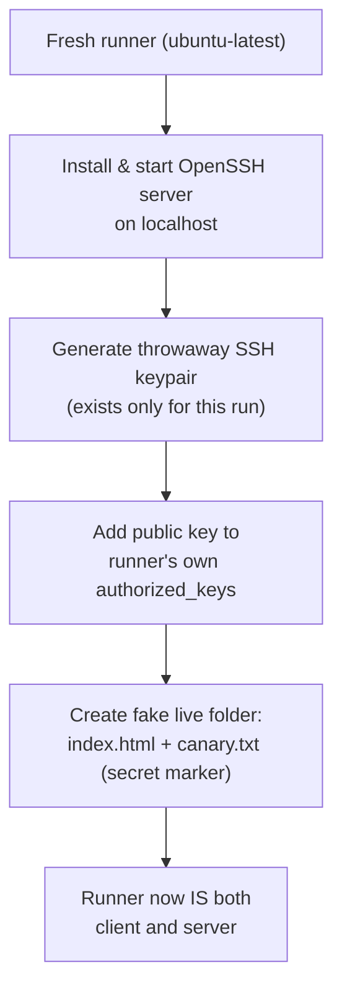

### Test 1 — normal deploy

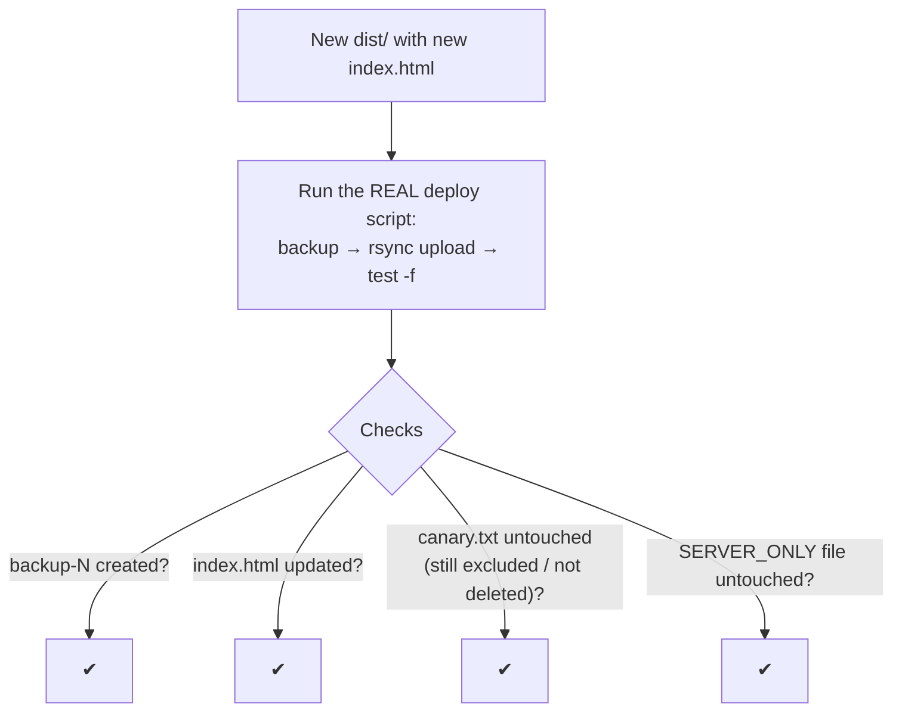

### Test 2 — forced failure → rollback

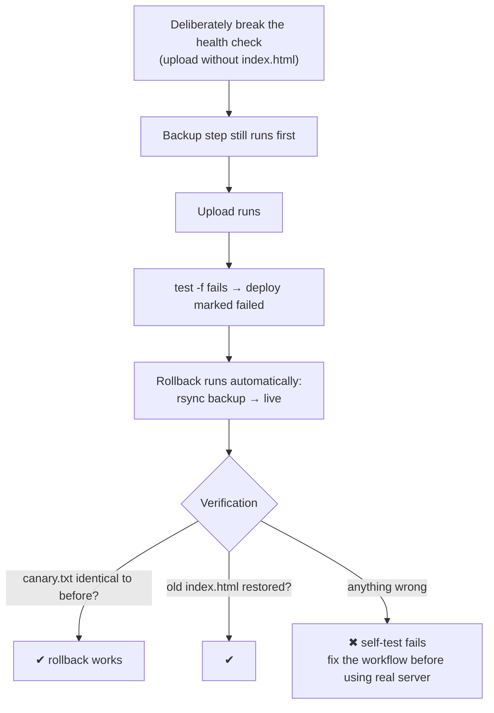

### Test 3 — keep-5 rotation

Run the backup step 7 times with fake run numbers; assert exactly 5 backup
folders remain and the oldest two are gone.

### How to run the self-test

1. **Manually:** GitHub → **Actions** tab → *Self-test* → **Run workflow**
   (button, top right).
2. **Automatically:** open any pull request — the self-test runs there too.
3. Everything (SSH server, keys, fake site) is created **inside the run** and
   thrown away with the runner. **No real secrets are used or printed.**

---

## 13. Secrets and Variables

Both live in the repo's **Settings → Secrets and variables** (top of the
GitHub repo page). The difference:

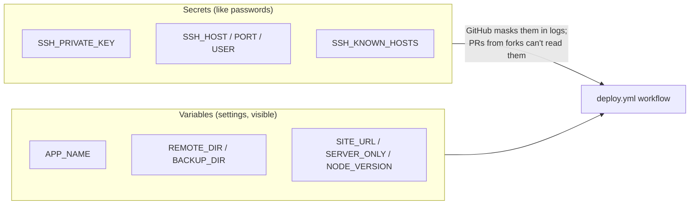

### Secrets (hidden — never written in files, never shown in logs)

| Secret | Meaning |
|--------|---------|
| `SSH_PRIVATE_KEY` | Private half of the SSH key allowed to log into the server. The matching **public** key is installed on the server (in `authorized_keys`). |
| `SSH_HOST` | Server address (e.g. `server.example.com`) — **placeholder until BigRock gives us the real value**. |
| `SSH_PORT` | SSH port (often `22`; the Jenkins practice server used `2222`) — **placeholder**. |
| `SSH_USER` | SSH username (cPanel often looks like `abcd1234`) — **placeholder**. |
| `SSH_KNOWN_HOSTS` | Pinned fingerprint of the server (produced by `ssh-keyscan`). Lets the runner **prove** it is talking to the real server and not an impostor (man-in-the-middle protection). |

### Variables (settings — not secret)

| Variable | Meaning |
|----------|---------|
| `APP_NAME` | Deploy folder name: `demo` for this repo, `demo-private` for the private one. Also names the concurrency group → each app has its own queue. |
| `REMOTE_DIR` | Absolute path of the live folder on the server (e.g. `/home/USER/public_html/demo`). |
| `BACKUP_DIR` | Absolute path of the backup folder — must be **outside** the live/web folder. |
| `SITE_URL` | Public URL of the site for the curl health check. Leave **empty** to skip this check. |
| `SERVER_ONLY` | Extra rsync excludes, one per line (e.g. `uploads/`, `config.php`). |
| `NODE_VERSION` | Node version for the runner (default `20`). |

### GitHub Environments (`demo` → `production`)

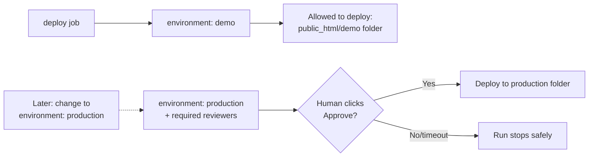

- The workflow is wired to the **`demo`** environment now — everything targets
  the demo folder only.
- Switching to `production` later is a **one-line change** in the workflow.
  Add *required reviewers* to the `production` environment and GitHub will
  pause every production deploy until a human approves it — the modern
  version of Jenkins' manual gate.

---

## 14. Jenkins → GitHub Actions cheat sheet

| Jenkins | GitHub Actions | Why the change |
|---------|----------------|----------------|
| `when { branch 'main' }` | `on: push: branches: [main]` (+ separate `pull_request` trigger) | Events replace branch conditions |
| `lock(resource: ...)` | `concurrency:` group keyed on `APP_NAME`, `cancel-in-progress: false` | Built-in queue, no plugin needed |
| `milestone(...)` | covered by the concurrency group | Queue in, older superseded runs wait/finish safely |
| `timeout(time: 20, unit: 'MINUTES')` | `timeout-minutes: 20` per job | Same idea, simpler syntax |
| `sshagent(['cpanel-ssh-key'])` | `webfactory/ssh-agent` (or manual `ssh-agent`) with `secrets.SSH_PRIVATE_KEY` | Credentials come from GitHub Secrets |
| `sh '...'` | `run: |` (bash steps) | Direct shell on the runner |
| `post { failure { ... } }` | `if: failure()` step | Same behavior |
| NodeJS tool `node20` | `actions/setup-node` with `vars.NODE_VERSION` | Tool install becomes a marketplace action |
| Credentials store + plugins | Repo Settings → Secrets / Environments | No Jenkins server to secure |

---

## 15. Open questions / TODO before the first real deploy

These values are **deliberately left as placeholders** — nobody has invented
them:

1. [ ] BigRock SSH **host**, **port**, **username** — must come from BigRock's
   panel or support ticket.
2. [ ] Exact absolute paths for `REMOTE_DIR` and `BACKUP_DIR` on the account
   (cPanel home layout differs per host).
3. [ ] Is **rsync installed** on the server? If not, we need a tar-over-SSH
   fallback — worth asking early.
4. [ ] Does BigRock **restrict SSH by IP address**? GitHub-hosted runners use
   **changing** IPs. If BigRock only allows certain IPs, this pipeline
   **cannot connect** from GitHub's runners. Options if that happens:
   - a **self-hosted runner** (a machine on an allowed IP),
   - allowlisting [GitHub's published IP ranges](https://api.github.com/meta),
   - asking BigRock to lift the restriction.
5. [ ] Create the GitHub Environments: **`demo`** now; **`production`** later
   (with required reviewers).
6. [ ] PHP support: the workflow contains the composer/`php -l`/phpunit steps,
   but this demo repo is Node-only — the PHP path gets its first real exercise
   when the first company PHP repo adopts the pipeline.
7. [ ] Decide where failure alerts should go (Slack / email / something else)
   and replace the placeholder `echo`.

---

## 16. How to verify a run

### On GitHub

1. Push a commit to `main` (or open a PR for a build/test-only run).
2. Repo page → **Actions** tab → click the workflow run.
3. Watch the stages:
   - **build** — green means install + build + tests all passed;
   - **deploy** — green means backup + upload + health check all worked.
4. If a step fails, click it and read the log — the failing command is the
   last thing printed.

### On the server (after a successful deploy)

```mermaid
flowchart TD
    subgraph Server["What you should see"]
        Live["public_html/demo/<br>• new index.html<br>• new assets/…<br>• NO .git/, NO node_modules/"]
        Bk["backups/demo/<br>backup-&#60;run&#62;/ ← brand-new copy<br>exactly 5 folders max"]
        Keep["Server-only files STILL THERE<br>.env, uploads/, config.php"]
    end
```

5. If the health check fails, the run turns **red** and the live folder is
   restored from the backup automatically — check the rollback step in the
   log and compare file dates on the server.

---

*Document version 1. Pipeline files: `.github/workflows/deploy.yml` (main
pipeline) and `.github/workflows/selftest.yml` (localhost rehearsal). Old
Jenkins definition kept in `Jenkinsfile` until the Actions pipeline is proven.*
