# GitHub Actions — Study Guide (Beginner → Pro)

A complete learning path for GitHub Actions, written for a junior backend
developer. Start at section 1 even if you have never written a YAML file;
finish at section 12 able to design production-grade pipelines like the one
in this repo (`docs/CICD-PIPELINE-EXPLAINED.md` explains **our** pipeline —
this guide teaches the **tool itself**).

**How to use this guide:**

- Read in order. Each section builds on the previous one.
- Every code block is meant to be **typed out and run** — learning CI by
  reading alone does not work. Push each example to a **practice branch**,
  open the **Actions** tab, and watch it.
- Diagrams are "mermaid" — on GitHub they render automatically; in VS Code
  press `Ctrl+Shift+V` (with the *Markdown Preview Mermaid* extension).

---

## Table of contents

1. [What problem does CI/CD solve?](#1-what-problem-does-cicd-solve)
2. [What is GitHub Actions, really?](#2-what-is-github-actions-really)
3. [Core concepts map](#3-core-concepts-map)
4. [Your first workflow (hello world)](#4-your-first-workflow-hello-world)
5. [YAML syntax crash course](#5-yaml-syntax-crash-course)
6. [Events — *when* things run](#6-events--when-things-run)
7. [Jobs and steps — *what* runs](#7-jobs-and-steps--what-runs)
8. [Expressions, contexts, and the `if` superpower](#8-expressions-contexts-and-the-if-superpower)
9. [Secrets and variables — configuration safely](#9-secrets-and-variables--configuration-safely)
10. [Tools you get for free (setup-node, cache, artifacts)](#10-tools-you-get-for-free-setup-node-cache-artifacts)
11. [Environments, approvals, concurrency, timeouts](#11-environments-approvals-concurrency-timeouts)
12. [Reusing pipelines (composite actions & reusable workflows)](#12-reusing-pipelines-composite-actions--reusable-workflows)
13. [Security best practices](#13-security-best-practices)
14. [Debugging and troubleshooting](#14-debugging-and-troubleshooting)
15. [Testing workflow logic locally](#15-testing-workflow-logic-locally)
16. [Pro playbook: patterns cheat sheet](#16-pro-playbook-patterns-cheat-sheet)
17. [Exercises (do these!)](#17-exercises-do-these)
18. [Cheat sheet + where our pipeline uses each concept](#18-cheat-sheet--where-our-pipeline-uses-each-concept)

---

## 1. What problem does CI/CD solve?

Imagine deploying by hand: copy files with FTP, forget a step, break the
site at 6 PM, scramble to find the old files.

**CI/CD automates that ritual:**

| Term | Meaning | Our equivalent |
|------|---------|----------------|
| **CI** (Continuous Integration) | Every push: build + test automatically | `build` job: `npm ci`, `npm run build`, lint |
| **CD** (Continuous Delivery/Deployment) | After CI passes: put code on the server | `deploy` job: rsync to cPanel |

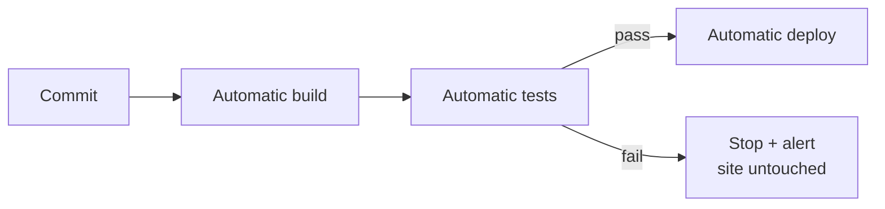

**The three promises of a good pipeline:**

1. **Same steps every time** — no "works on my machine".
2. **Fail fast** — broken code is caught in minutes, not production.
3. **Safe to ship** — backups, checks, rollback (see our pipeline doc).

---

## 2. What is GitHub Actions, really?

GitHub Actions is a **CI/CD service built into GitHub**. When something
happens in your repo (push, PR, issue, schedule, button click), GitHub can
start a **temporary virtual machine** ("runner"), give it your code, and run
commands you define — all described in files that live **inside your repo**.

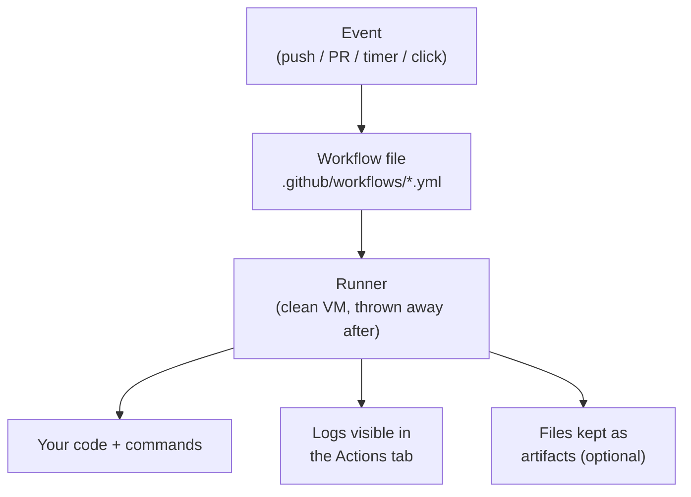

**Why it beats classic Jenkins for small teams:**

- No server to rent, patch, or secure — GitHub runs the machines.
- Configuration lives in the repo (reviewed in PRs like normal code).
- Free minutes for public repos; generous free tier for private ones.
- Secrets are stored encrypted by GitHub and masked in logs.

**Vocabulary trap:** "Actions" also means small reusable third-party steps
from the Marketplace (e.g. `actions/checkout`). Same word, two meanings —
workflow = the recipe; action = a pre-built ingredient.

---

## 3. Core concepts map

Five words. Learn them and you have 80% of the mental model.

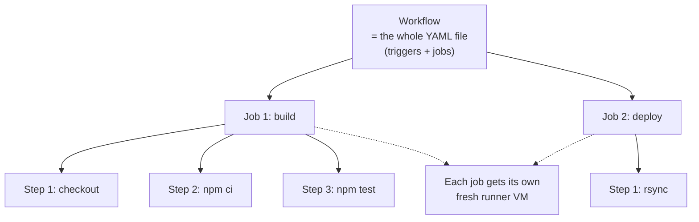

| Concept | One-line definition | Analogy |
|---------|---------------------|---------|
| **Workflow** | One YAML file in `.github/workflows/` with triggers + jobs | The whole recipe |
| **Event** | What starts the workflow (`push`, `pull_request`, ...) | "When the bell rings" |
| **Job** | A unit of work that runs on **its own runner**; jobs run in parallel by default; use `needs:` for order | A station in a kitchen |
| **Step** | One command or one action inside a job; steps run **sequentially** | A single cooking action |
| **Action** | A reusable step published by someone (`actions/checkout`) | A pre-made sauce |
| **Runner** | The temporary machine that executes the job | The chef's workspace |
| **Context/Expression** | `${{ ... }}` — way to read data (secrets, branch name, ...) | "Look this up while cooking" |
| **Environment** | A named deploy target with optional human approval | "The pass window before serving" |

**Critical facts to memorize:**

- Steps in the same job share the same machine (and working directory).
- Jobs do **not** share a machine — pass data between them with
  `outputs` and `needs`.
- A failed **step** fails the whole **job**. A failed job (that others
  depend on) skips them.
- Runners start clean every time — always install what you need
  (`setup-node`, `npm ci`...). Nothing survives between runs unless you use
  **cache** or **artifacts**.

---

## 4. Your first workflow (hello world)

Create `.github/workflows/hello.yml` on a **practice branch** (never test
on `main` while learning):

```yaml
name: Hello

on:
  push:
    branches: [main]

jobs:
  greet:
    runs-on: ubuntu-latest
    steps:
      - name: Say hello
        run: echo "Hello from GitHub Actions!"
      - name: Show where we are
        run: pwd && ls -la
```

**What each line means:**

| Line | Meaning |
|------|---------|
| `name:` | Title shown in the Actions tab |
| `on:` | The triggers (which events start this workflow) |
| `jobs:` | The jobs in this workflow (here: one job called `greet`) |
| `runs-on:` | Which runner OS (ubuntu / windows / macos) |
| `steps:` | The list of things to do, in order |
| `run:` | A shell command (bash on ubuntu) |

**Verify:** push the branch → repo → **Actions** tab → click *Hello* →
click the run → read the logs. You just ran code on a computer you don't
own, triggered by a git push. That is the whole magic of CI.

---

## 5. YAML syntax crash course

GitHub Actions files are **YAML**. Four rules cover 95% of what you need:

1. **Indentation with spaces only** (2 spaces standard). Tabs are an error.
2. **Key: value** pairs. A value can be text, a number, a list, or a block.
3. **Lists** start with `- ` (dash + space):

   ```yaml
   branches:
     - main
     - develop
   # same as:  branches: [main, develop]
   ```

4. **Multi-line blocks** use `|` (keep newlines — for shell scripts) or `>`
   (join lines):

   ```yaml
   run: |
     echo line one
     echo line two
   # runs as a script, not one giant line
   ```

**The most common beginner bugs:**

| Bug | Symptom | Fix |
|-----|---------|-----|
| Tab character | "Invalid workflow file" error | Convert tabs to 2 spaces |
| Wrong indent level | Same error; point your eyes at the line number GitHub shows | Match indentation of sibling keys |
| Unquoted `*` or `:` in text | YAML parse error | Wrap the text in `"quotes"` |
| `on:` written as `on` without colon | Trigger never fires | `on:` with colon |
| Forgetting `runs-on` | Job fails immediately | Every job needs it |

**Golden habit:** after editing a workflow, use an editor with a YAML
plugin that highlights errors (VS Code does this for free), and read
GitHub's error message carefully — it points to the exact line.

---

## 6. Events — *when* things run

`on:` decides the triggers. The ones you will actually use:

| Event | Fires when | Typical use |
|-------|------------|-------------|
| `push` | Commits land on a branch | Build/deploy on merge to main |
| `pull_request` | PR opened / updated | Build + test before merge |
| `workflow_dispatch` | Human clicks **Run workflow** in the UI | Manual deploys, rehearsals |
| `schedule` | Cron timer | Nightly builds, cleanup jobs |
| `release` | GitHub release published | Build + attach binaries |

### Filtering by branch

```yaml
on:
  push:
    branches: [main]          # only main
  pull_request:
    branches: [main]          # PRs whose TARGET is main
```

### The classic "PR tests, main deploys" pattern

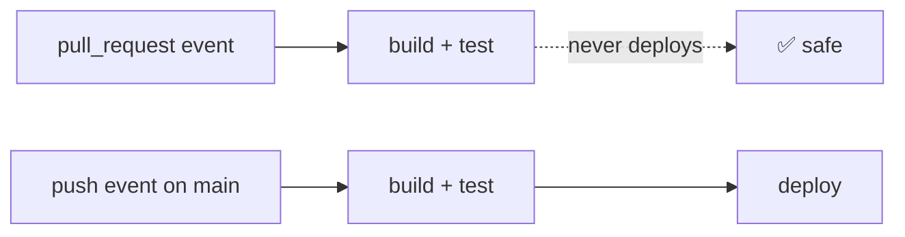

You control this with **two triggers + one `if`** on the deploy job
(shown in section 8). This is exactly how our `deploy.yml` works.

### Manual runs (the button you will love)

```yaml
on:
  workflow_dispatch:
```

After this is on the branch, the Actions tab shows a **Run workflow**
button with optional inputs. Perfect for rehearsals — our self-test
workflow uses it.

---

## 7. Jobs and steps — *what* runs

### Jobs run in parallel, steps run in order

```yaml
jobs:
  build:            # starts immediately
    runs-on: ubuntu-latest
    steps:
      - run: echo "first"
      - run: echo "second"   # after "first" finishes

  test:             # runs AT THE SAME TIME as build
    runs-on: ubuntu-latest
    steps:
      - run: echo "parallel!"
```

### Making jobs wait: `needs`

```yaml
jobs:
  build:
    runs-on: ubuntu-latest
    steps:
      - run: echo "build"

  deploy:
    needs: build              # waits for build to succeed
    runs-on: ubuntu-latest
    steps:
      - run: echo "deploy"
```

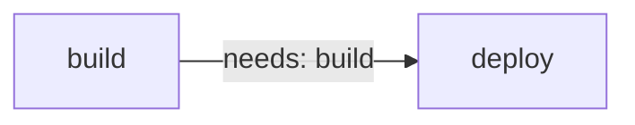

If `build` fails, `deploy` is **skipped** (shown gray in the UI). This is
how "a failing test stops the pipeline" works — no `if` needed!

### Passing data from a job to another: `outputs`

```yaml
jobs:
  build:
    runs-on: ubuntu-latest
    outputs:
      folder: ${{ steps.detect.outputs.folder }}   # expose to other jobs
    steps:
      - id: detect                 # give the step an id
        run: echo "folder=dist" >> "$GITHUB_OUTPUT"

  deploy:
    needs: build
    runs-on: ubuntu-latest
    steps:
      - run: echo "will deploy ${{ needs.build.outputs.folder }}"
```

Two variables worth knowing inside `run:` scripts:

- `$GITHUB_OUTPUT` — file a step writes to in order to export an output
  (`echo "name=value" >> "$GITHUB_OUTPUT"`).
- `$GITHUB_ENV` — file that sets an **environment variable for all later
  steps in the same job** (`echo "MODE=prod" >> "$GITHUB_ENV"`).

### Two kinds of step

```yaml
steps:
  - name: Using a prebuilt action
    uses: actions/checkout@v4      # <-- "uses" = pull reusable action
    with:                          # <-- inputs that action accepts
      fetch-depth: 0

  - name: Running my own command
    run: npm ci                    # <-- "run" = shell command
```

- `uses:` — reuse someone's tested step (always pin a version like `@v4`).
- `run:` — your own bash (or `shell: pwsh` / `shell: python` if you set it).

### Matrix: test on many versions at once

```yaml
jobs:
  test:
    runs-on: ubuntu-latest
    strategy:
      matrix:
        node: [20, 22]            # two parallel jobs, one per version
    steps:
      - uses: actions/setup-node@v4
        with:
          node-version: ${{ matrix.node }}
      - run: npm ci
      - run: npm test
```

One job definition → two runners → results side by side. Pro move for
"does this work on Node 20 AND 22?".

---

## 8. Expressions, contexts, and the `if` superpower

`${{ ... }}` lets you **compute values** from GitHub's data:

```yaml
if: github.ref == 'refs/heads/main'
run: echo "we are on main, ref is ${{ github.ref }}"
```

| Context (the data) | Useful fields |
|--------------------|---------------|
| `github` | `github.ref`, `github.event_name`, `github.actor`, `github.sha` |
| `needs` | `needs.<job>.outputs.<name>`, `needs.<job>.result` |
| `vars` | Repository/environment **variables** (non-secret) |
| `secrets` | Repository/environment **secrets** |
| `env` | Environment variables defined in the workflow |

**Everyday expressions:**

```yaml
if: github.event_name == 'push' && github.ref == 'refs/heads/main'
if: github.event_name == 'pull_request'          # PRs only
if: always()                                     # run even if previous failed
if: failure()                                    # only if something failed (alerts!)
if: contains(github.event.head_commit.message, '[skip ci]')
env:
  APP: ${{ vars.APP_NAME }}                     # read a variable
  KEY: ${{ secrets.SSH_PRIVATE_KEY }}           # read a secret (masked in logs)
```

### The "deploy only from main" gate — one line of `if`

```yaml
jobs:
  deploy:
    needs: build
    if: github.event_name == 'push' && github.ref == 'refs/heads/main'
    runs-on: ubuntu-latest
    steps:
      - run: echo "deploying"
```

- PR event → condition false → deploy job gray/skipped ✔
- Push to a feature branch → skipped ✔
- Push to main → runs ✔

This is exactly Layer 5 of our pipeline. Memorize this pattern — you will
use it in every project that ships to a server.

### Job-level vs step-level `if`

```yaml
jobs:
  deploy:
    if: github.ref == 'refs/heads/main'    # job skipped entirely
    steps:
      - run: echo "upload"
      - name: alert
        if: failure()                      # step only runs when the job fails
        run: echo "ALERT: deploy failed"
```

---

## 9. Secrets and variables — configuration safely

**Rule of thumb:** *Would you be upset if this appeared in a screenshot?*
Secret. Otherwise → variable (or plain workflow constant).

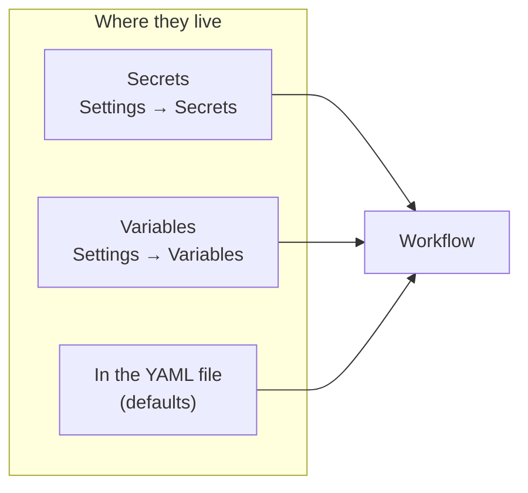

### Where to add them (click path)

1. GitHub repo page → **Settings**
2. Left sidebar → **Secrets and variables** → **Actions**
3. **Secrets** tab → *New repository secret* (value hidden forever after save)
4. **Variables** tab → *New repository variable* (value visible to anyone
   with read access — keep it non-sensitive)

### Using them

```yaml
jobs:
  deploy:
    runs-on: ubuntu-latest
    steps:
      - run: |
          echo "Host is ${{ vars.SSH_HOST }}"          # variable, visible
          echo "Key length: ${{ length(secrets.SSH_PRIVATE_KEY) }}"  # secret, SAFE
      - run: echo "${{ secrets.SSH_PRIVATE_KEY }}"     # ⚠️ DON'T do this in logs
```

**Why never `echo` a secret:** GitHub **masks** secrets in logs (replaces
with `***`), but printing them is still a bad habit — masking has edge
cases (secrets inside archives, base64, etc.). Pass secrets into tools via
environment variables or files instead:

```yaml
- name: Write key to file (masked-safe pattern)
  env:
    SSH_KEY: ${{ secrets.SSH_PRIVATE_KEY }}
  run: |
    umask 077
    printf '%s\n' "$SSH_KEY" > ~/.ssh/id_ed25519
```

### Three levels of variables

| Level | Where set | Scope | Example |
|-------|-----------|-------|---------|
| Workflow-level | `env:` block in YAML | whole workflow | `NODE_VERSION` default |
| Repository | Settings → Variables/Secrets | all workflows in repo | `APP_NAME` |
| Environment | Settings → Environments → env vars | jobs using that environment | prod DB URL |

Precedence: environment value overrides repository value. That is how one
workflow can deploy `demo` with one config and `production` with another —
**same file, different environment**.

---

## 10. Tools you get for free (setup-node, cache, artifacts)

### Checkout — almost every job needs it

```yaml
- uses: actions/checkout@v4
```

The runner does **not** magically contain your code. This action clones
the repo into the runner. Without it, `ls` shows an empty folder.

### setup-node — correct Node version + npm cache

```yaml
- uses: actions/setup-node@v4
  with:
    node-version: ${{ vars.NODE_VERSION || 20 }}
    cache: npm            # caches ~/.npm keyed by package-lock.json
```

### Cache — do not re-download dependencies

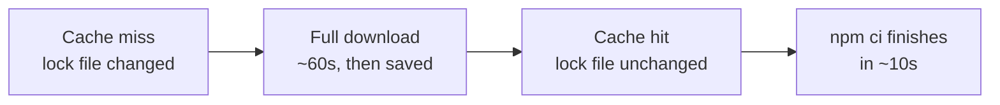

`cache: npm` in setup-node is enough for Node projects. The cache is keyed
by the hash of `package-lock.json` — when your lock file changes, the cache
is refreshed automatically.

### Artifacts — pass files between jobs / download after the run

```yaml
jobs:
  build:
    runs-on: ubuntu-latest
    steps:
      - run: npm run build
      - uses: actions/upload-artifact@v4
        with:
          name: dist
          path: dist/

  deploy:
    needs: build
    runs-on: ubuntu-latest
    steps:
      - uses: actions/download-artifact@v4
        with:
          name: dist
          path: dist/
      - run: rsync -a dist/ server:...
```

Artifacts = bridge between jobs (they do **not** share a disk). Also useful
as "evidence": upload test reports or the built `dist/` so anyone can
download exactly what was shipped.

> Design choice in **our** pipeline: deploy rebuilds instead of using
> artifacts, to keep the workflow simpler for a junior team. Both patterns
> are valid; artifacts are the stricter "build once, deploy same bytes"
> approach you may see at bigger companies.

### Useful bundled tools on `ubuntu-latest`

`git`, `curl`, `jq`, `rsync`, `openssh-client`, `docker`, Python, and more
are preinstalled. PHP is **not** — that's why our workflow adds
`shivammathur/setup-php` when `composer.json` exists.

---

## 11. Environments, approvals, concurrency, timeouts

### Environments = named deployment targets with gates

```yaml
jobs:
  deploy:
    environment: production     # <- GitHub pauses here if reviewers required
    runs-on: ubuntu-latest
```

Setup in repo **Settings → Environments**:

1. Create `demo` — no restrictions (auto-deploys).
2. Create `production` — add **Required reviewers** (your tech lead).
3. Optionally different secrets/variables **per environment**.

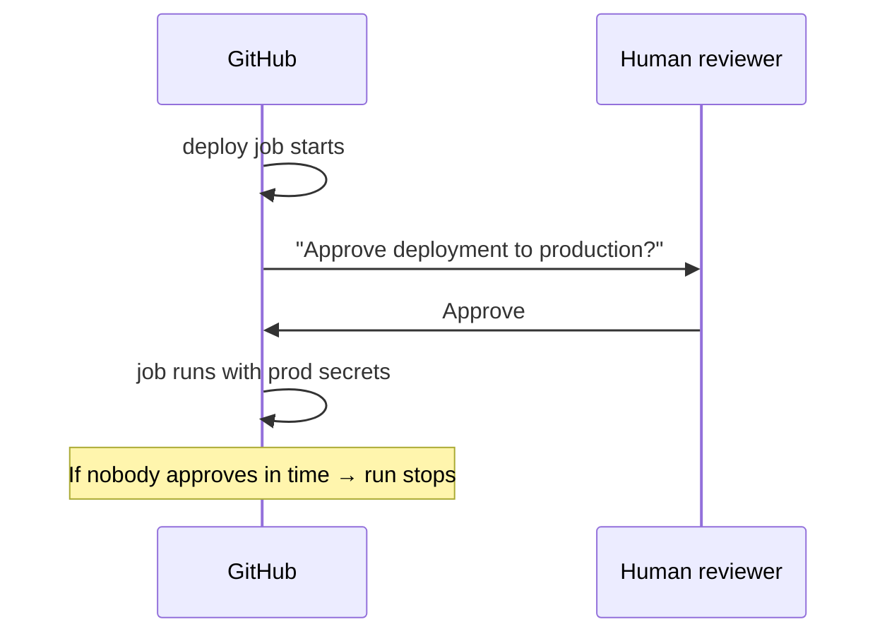

This is the modern replacement for "only the release manager may press
the deploy button" in Jenkins.

### Concurrency — one deploy at a time (never cancel halfway!)

```yaml
concurrency:
  group: deploy-${{ vars.APP_NAME }}
  cancel-in-progress: false     # WAIT, do not kill a running deploy
```

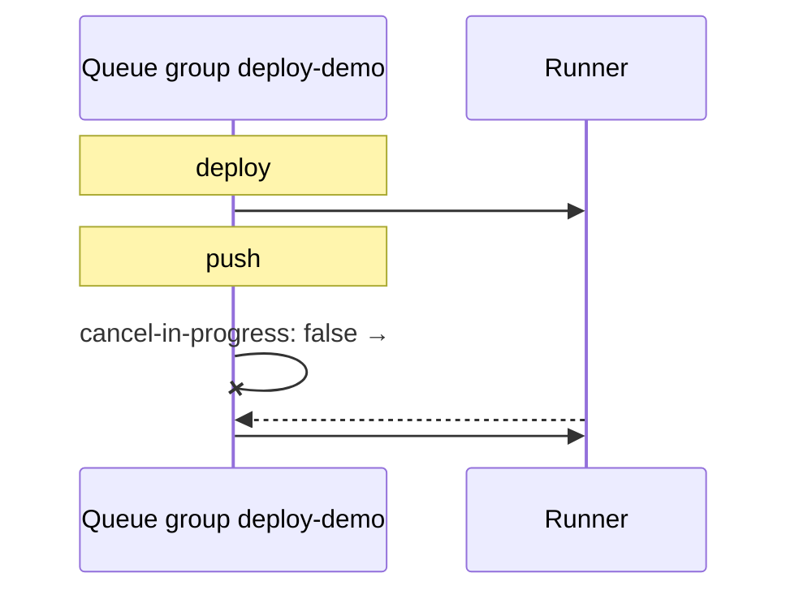

**When `cancel-in-progress: true` is fine:** build/test-only workflows
(thrilled to kill outdated PR builds and save minutes). **When it is
dangerous:** any workflow that uploads to a server — a cancelled deploy can
leave a half-updated site. Our pipeline uses `false` for deploys on purpose.

### Timeouts

```yaml
jobs:
  deploy:
    timeout-minutes: 20         # default is 360 — too long for a queue block
```

A hung SSH connection would otherwise hold the concurrency group for hours.

### Recap: Layer 5 of our pipeline = these three features

| Jenkins needed plugins/locks for | GitHub Actions built-in |
|----------------------------------|-------------------------|
| Lockable Resources (lock) | `concurrency` group |
| Throttle / milestone | same group + `cancel-in-progress: false` |
| Build timeout plugin | `timeout-minutes` |
| Input step / manual gate | `environment` + required reviewers |

---

## 12. Reusing pipelines (composite actions & reusable workflows)

As the second, third, tenth repo adopt the pipeline, **copy-paste becomes a
bug farm**. Two reuse tools solve this:

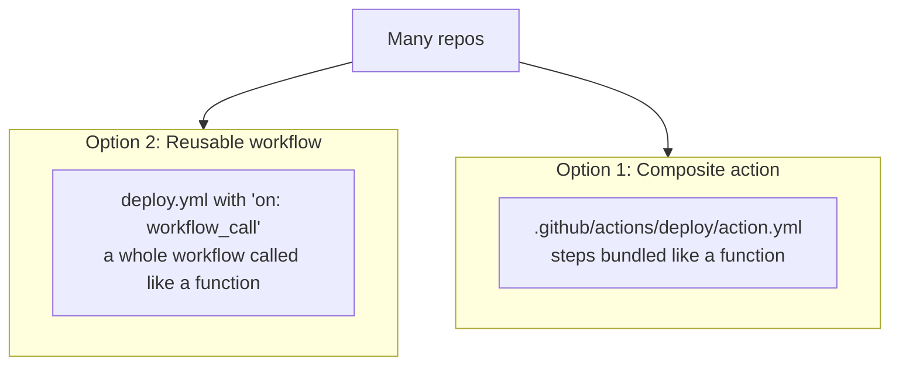

### Composite action (reuse steps inside ONE repo)

`.github/actions/rsync-deploy/action.yml`:

```yaml
name: Rsync deploy
inputs:
  target:
    required: true
runs:
  using: composite
  steps:
    - shell: bash
      run: rsync -az --delete dist/ ${{ inputs.target }}
```

Use it:

```yaml
- uses: ./.github/actions/rsync-deploy
  with:
    target: user@host:/var/www/demo
```

### Reusable workflow (reuse the WHOLE pipeline across REPOS)

In `demo-public/.github/workflows/deploy.yml`:

```yaml
on:
  push:
    branches: [main]
  workflow_call:            # <- allow other repos to call this workflow
    inputs:
      app_name:
        required: true
        type: string
```

In **another repo**'s workflow:

```yaml
jobs:
  run_pipeline:
    uses: Techvenom18/demo-public/.github/workflows/deploy.yml@main
    with:
      app_name: demo-private
    secrets: inherit
```

**Our pragmatic plan:** keep each repo's `deploy.yml` **self-contained for
now** (easier for a junior team to read and debug), with the deploy section
clearly delimited so extraction into a reusable workflow later is
mechanical. Learn composite actions first — they are the simpler tool.

---

## 13. Security best practices

The pipeline holds your **server key**. Treat it like production code.

1. **Pin third-party actions to a full commit SHA**, not just `@v4`, when
   security matters — a tag can be moved by a compromised maintainer:

   ```yaml
   - uses: actions/checkout@a5ac7e51b41094c92402da3b24376905380afc29 # v4.6.0
   ```

   (GitHub's own `actions/*` at a major tag is acceptable for most small
   teams; be stricter for anything with deploy credentials.)

2. **Least privilege for `GITHUB_TOKEN`** — default token only needs what
   you use:

   ```yaml
   permissions:
     contents: read          # pipeline only reads the code
   ```

3. **Never pass secrets to `pull_request` workflows from forks** — the PR
   code could print them. Our design: **PRs never receive deploy secrets**
   (the deploy job doesn't even run).

4. **Mask, don't print.** No `echo ${{ secrets.X }}`. Prefer files +
   `umask 077` for keys.

5. **Branch protection on `main`** — require the CI check to pass before
   merge. The pipeline is only as strong as the rule that forces it to run.

6. **Review who can approve production deployments** (environment
   reviewers) — one mis-click is a deploy.

7. **Audit old runs** — logs of *public* repos are visible to everyone;
   never print anything sensitive even on private repos (logs are kept a
   long time).

---

## 14. Debugging and troubleshooting

### Read the failure like a detective

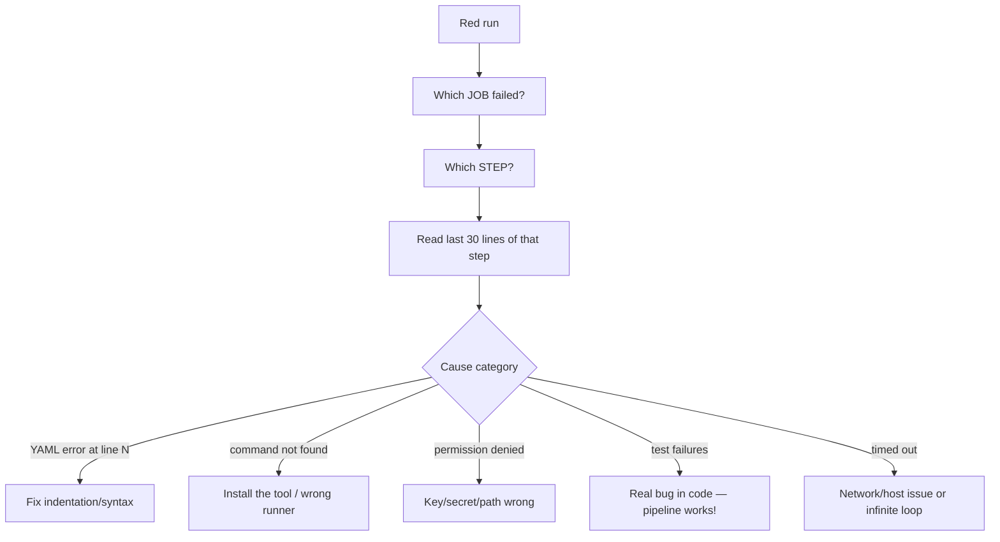

### Tools to turn on

| Tool | How | What it gives you |
|------|-----|-------------------|
| Step debug logs | `ACTIONS_STEP_DEBUG: "true"` in repo variables | Much more verbose step logs |
| Command echo | `set -x` at the top of a `run:` block | Prints each command before running |
| SSH debug | `ssh -vvv` (our workflow has a debug toggle) | Why the SSH connection fails |
| Re-run with logs | *Re-run failed jobs* button | Fix code without redeploying everything |

### Frequent beginner errors, decoded

| Error text (approximate) | Real meaning | Fix |
|--------------------------|--------------|-----|
| "Invalid workflow file ... line X" | YAML syntax/indent | Fix line X, validate in editor |
| "Can't find package-lock.json" | `npm ci` without lock file, or wrong working dir | Use `npm install` fallback or commit the lock file |
| "Permission denied (publickey)" | SSH key not loaded / wrong key | Check ssh-agent step + secret content |
| "Connection timed out" | Network / firewall / **IP allowlist** | See BigRock IP-risk note in our pipeline doc |
| Job gray "skipped" | An `if` was false or `needs` failed | Print `github.ref` / `event_name` in a debug step |
| "Secret not found" | Typo in name, or secret only exists in another env | Match names exactly; check environment scope |

### Local validation before pushing (saves many red runs)

```bash
# VS Code: YAML extension gives inline errors — cheapest option

# Actionlint: linter for workflow files (pro move)
# https://github.com/rhysd/actionlint
actionlint .github/workflows/deploy.yml
```

---

## 15. Testing workflow logic locally

Much of a workflow is **just bash** — and bash runs on your machine.

### 15.1 Extract scripts and run them directly

```bash
# Save the rsync/backup script to scripts/deploy.sh, then in YAML:
#   - run: bash scripts/deploy.sh
# Test locally:
bash scripts/deploy.sh
```

Bonus: the same file can be `shellcheck`-ed and reviewed like normal code.

### 15.2 Test the dangerous parts against localhost (our strategy)

GitHub runners cannot reach your laptop. Instead, **the runner becomes its
own server** — this is precisely what this repo's `selftest.yml` does:

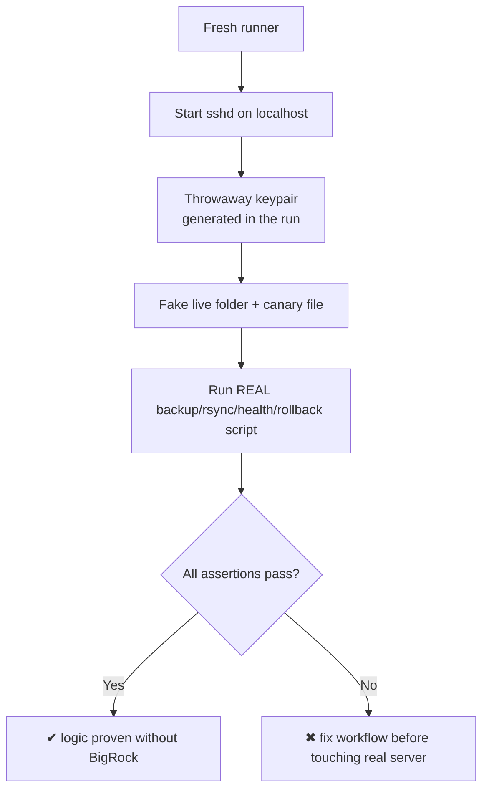

No secrets involved; the whole setup dies with the runner. **Run the
self-test before every change to deploy logic.**

### 15.3 act — run workflows in Docker locally (advanced)

[`act`](https://github.com/nektos/act) emulates GitHub runners with Docker:

```bash
act push          # runs the 'push' workflows locally
act -l            # list jobs
```

**Caveats for our team:** `act` needs Docker, behaves *almost* like GitHub
(not 100%), and SSH-into-localhost tricks are awkward inside containers.
Useful for quick YAML sanity checks; rely on the self-test workflow for
deploy logic.

---

## 16. Pro playbook: patterns cheat sheet

Patterns you will want within your first month:

```yaml
# 1) Skip useless runs (save minutes)
if: "! contains(github.event.head_commit.message, '[skip ci]')"

# 2) Fail the run only if a specific step fails later
#    (alert step runs on failure, without masking the real error)
- name: Alert
  if: failure()
  run: echo "ALERT: deploy failed"

# 3) Continue other steps when one optional tool is missing
- run: npm run lint --if-present

# 4) Guard a dangerous step twice: job-level if + step-level if
jobs:
  deploy:
    if: github.ref == 'refs/heads/main'
    steps:
      - if: vars.DEPLOY_ENABLED == 'true'
        run: ./deploy.sh

# 5) Timezone-honest cron (UTC, not your laptop time!)
on:
  schedule:
    - cron: "0 3 * * 1-5"    # 03:00 UTC, Mon-Fri

# 6) Dynamic matrix from a previous job's output
strategy:
  matrix:
    target: ${{ fromJson(needs.list.outputs.targets) }}

# 7) Best-effort cleanup that never fails the job
- run: ./cleanup.sh
  if: always()

# 8) One concurrency group per app, queued not cancelled
concurrency:
  group: deploy-${{ vars.APP_NAME }}
  cancel-in-progress: false
```

**Pro habits (the difference between "script kid" and engineer):**

- Treat workflow files as **code**: PRs, review, actionlint.
- Keep `run:` blocks short; complex logic → `scripts/*.sh` in the repo.
- Separate **build/test** from **deploy** into two jobs (secrets only in
  deploy).
- Log what you deploy: `git rev-parse --short HEAD`, run number, timestamp
  (our pipeline writes `version.txt` for this).
- When something breaks at 2 AM, the doc you wrote last month saves you —
  keep the runbook (like our `CICD-PIPELINE-EXPLAINED.md`) next to the
  workflow.

---

## 17. Exercises (do these!)

Work through them on a **practice repo**. Each maps to a skill above.

1. **Hello Actions** — create a workflow that runs `echo` on push. Find it
   in the Actions tab. (Sections 4–5)
2. **PR sentinel** — trigger on `pull_request`, print
   `${{ github.event.pull_request.title }}` in a step. Open a PR and watch
   it. (Section 6)
3. **The gate** — copy exercise 2 and add `if: github.ref ==
   'refs/heads/main'` to a second job; confirm it skips on PRs and runs on
   main. (Section 8)
4. **Secret spy test** — add a secret, print it, see `***` masking. Then
   print its length instead and see the real number. Understand the
   difference. (Section 9)
5. **Setup + cache** — build this Vite app in CI: checkout → setup-node
   with `cache: npm` → `npm ci` → `npm run build` → upload `dist/` as an
   artifact. Download the artifact from the UI and open `index.html`
   locally. (Section 10)
6. **Queue, don't cancel** — add a `concurrency` group with
   `cancel-in-progress: false` and a `run: sleep 120` job. Push twice
   quickly; observe the second run **waiting**. (Section 11)
7. **Manual button** — add `workflow_dispatch`, run it from the UI, change
   an input, run again. (Section 6)
8. **Localhost deploy** — run this repo's self-test workflow; then break
   it on purpose (bad path) and read the failure like a detective. (Section 15)
9. **Matrix pro** — extend exercise 5 with a matrix over Node 20 + 22.
   (Section 7)
10. **Mini-pipeline** — without looking, write from memory: PR → build/test;
    push main → deploy with backup + health check + `if: failure()` alert.
    Compare with `deploy.yml` in this repo. (Everything)

---

## 18. Cheat sheet + where our pipeline uses each concept

### One-page cheat sheet

```yaml
name: My workflow
on:                              # WHEN
  push:
    branches: [main]
  pull_request:
  workflow_dispatch:

concurrency:                     # ONE AT A TIME (optional)
  group: deploy-${{ vars.APP_NAME }}
  cancel-in-progress: false

permissions:
  contents: read                 # LEAST PRIVILEGE

jobs:
  build:                         # WHAT (parallel unit)
    runs-on: ubuntu-latest       # WHERE
    timeout-minutes: 20          # SAFETY
    outputs:
      dist: ${{ steps.detect.outputs.dist }}
    steps:
      - uses: actions/checkout@v4
      - uses: actions/setup-node@v4
        with:
          node-version: ${{ vars.NODE_VERSION || 20 }}
          cache: npm
      - id: detect
        run: echo "dist=dist" >> "$GITHUB_OUTPUT"
      - run: npm ci && npm run build --if-present

  deploy:
    needs: build
    if: github.event_name == 'push' && github.ref == 'refs/heads/main'
    runs-on: ubuntu-latest
    environment: demo            # GATE + per-env config
    steps:
      - uses: actions/checkout@v4
      - env:
          KEY: ${{ secrets.SSH_PRIVATE_KEY }}
        run: install key safely
      - run: backup, rsync, health-check
      - if: failure()
        run: rollback + alert
```

### Concept → our pipeline map

| Concept | Where it lives in this repo |
|---------|-----------------------------|
| `push` / `pull_request` triggers | `deploy.yml` → `on:` |
| `workflow_dispatch` | `deploy.yml`, `selftest.yml` (manual rehearsal button) |
| Project detection with step outputs | `deploy.yml` build job (`id: detect`) |
| `needs` between build and deploy | `deploy.yml` |
| Secrets (`SSH_*`) + variables (`APP_NAME`, ...) | `deploy.yml` deploy job |
| `environment: demo` | `deploy.yml` deploy job |
| `concurrency` + `cancel-in-progress: false` | `deploy.yml` top-level |
| `timeout-minutes` | both jobs |
| `if: failure()` alert | `deploy.yml` end |
| Localhost SSH rehearsal | `selftest.yml` |
| Layered safety theory | `docs/CICD-PIPELINE-EXPLAINED.md` |

---

*You have reached the end. Next practical step in THIS repo: build the real
`.github/workflows/deploy.yml` using sections 6–11 as your reference, then
run `selftest.yml` before any real server is involved. When you maintain
this pipeline in six months, reread sections 13 and 16 first.*
