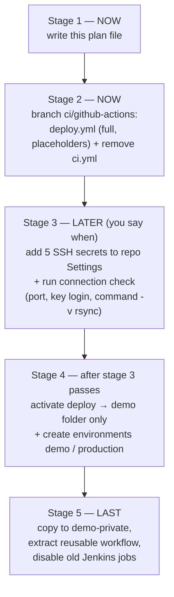

# Workflow Explanation — Deploy Plan (demo-public + demo-private)

This document is the **implementation plan** for porting our proven Jenkins
pipeline to GitHub Actions using **Method B (SSH + rsync from the workflow)**.
It covers **both** demo repos, defines the exact file changes, maps all 5
protection layers to YAML, and lists every placeholder and open question.

Companion documents:

- `docs/CICD-PIPELINE-EXPLAINED.md` — how the pipeline behaves (flowcharts of
  backup, rsync, health check, rollback, concurrency).
- `docs/GITHUB-ACTIONS-STUDY-GUIDE.md` — GitHub Actions from beginner to pro
  (on `main`).

**Branch this plan is executed on:** `ci/github-actions` (never push deploy
work straight to `main`; never merge without an explicit ask).

---

## 1. Goal and decision

**Goal:** when code is pushed or merged to `main`, GitHub Actions must
automatically **build → test → deploy** to BigRock shared-hosting cPanel,
replacing the slow manual upload — with the same safety behavior as the
Jenkins pipeline we already proved in Docker.

**Decision: Method B — SSH + rsync run from the workflow.**

| | Method A: cPanel Git Version Control + API token | **Method B: SSH + rsync (CHOSEN)** |
|---|---|---|
| How | cPanel API makes the server pull a branch, runs `.cpanel.yml` | The GitHub runner logs in over SSH and copies files with rsync |
| Backups / health check / rollback / lock | **Not included** — must be built on top | Built directly into the workflow (same commands as our Jenkinsfile) |
| Where built files (`dist/`) come from | Would have to be **committed to the repo** | Built on the runner and uploaded — repo stays clean |
| Requirements | cPanel API token (can act on the whole account — high risk) | SSH host/port/user + key, `rsync` on the server |
| Unknowns | cPanel API version / permissions | Whether GitHub's changing runner IPs can reach BigRock SSH |

**Why B:** we already have SSH key access on cPanel, and B lets us keep the
exact protection-layer commands that already worked in Jenkins.

> **SSH keys: we HAVE them, but we do NOT configure them yet.**
> The first implementation stage writes the complete workflow file with
> **placeholders only**. Secrets (the keys) get added in a later stage,
> explicitly approved. No key, token, or password is ever written into a
> file in this repo, echoed in a log, or committed to git.

---

## 2. Repos covered by this plan

| | `demo-public` | `demo-private` |
|---|---|---|
| Remote | `github.com/Techvenom18/demo-public` | `github.com/Techvenom18/demo-private` |
| Local folder | `D:\code\demo-public` | `D:\code\demo-private` |
| Visibility | public | private |
| Stack | Vite app → `dist/` | Vite app → `dist/` |
| Existing CI | `.github/workflows/ci.yml` (green on `main`) | none yet |
| CI after this plan | **`ci.yml` replaced by `deploy.yml`** | `deploy.yml` copied in a later step |
| Build/test secrets needed | none | none (build/test works on private repos with built-in `GITHUB_TOKEN`) |
| Deploy secrets needed | 5 × `SSH_*` (added LATER, not now) | same 5 names, set in **its own** Settings page |
| `APP_NAME` variable | `demo` | `demo-private` |
| Deploy target | server folder for demo | separate server folder for demo-private |
| History note | — | Jenkins read it via a read-only GitHub deploy key (proof private-repo CI works) |

**Same workflow file works for both** — all per-repo differences (app name,
paths, URL) live in repository **variables**, so the YAML is identical in
both repos. Scaling to the company's PHP repos later = same file + the
PHP branch of the build logic (composer, `php -l`, phpunit), already planned
as commented placeholders.

---

## 3. File changes (stage 2 — the first code change)

| File | Action | Why |
|---|---|---|
| `.github/workflows/deploy.yml` | **CREATE** (full file, placeholders) | One workflow = all three stages, like the Jenkinsfile |
| `.github/workflows/ci.yml` | **DELETE** in the same commit | Its 6 steps move unchanged into `deploy.yml`'s `build-test` job — nothing is lost; keeping both would run the same build twice on every push |

### Shape of `deploy.yml`

```yaml
name: Deploy

on:
  push:
    branches: [main]          # a push to main: build + test + (later) deploy
  pull_request:
    branches: [main]          # a PR toward main: build + test ONLY
  workflow_dispatch:          # manual button in the Actions tab

concurrency:
  group: deploy-${{ vars.APP_NAME }}   # one queue per app
  cancel-in-progress: false            # NEVER kill a running deploy

permissions:
  contents: read              # workflow can only read the repo

jobs:
  build-test:                 # == Jenkins Checkout + Build + Test stages
    runs-on: ubuntu-latest
    timeout-minutes: 15
    steps: ...                # exactly today's ci.yml steps + detect step
    outputs: upload, health_file

  deploy:                     # == Jenkins Deploy stage (Layer 2-5)
    needs: build-test
    if: github.event_name == 'push' && github.ref == 'refs/heads/main'
    runs-on: ubuntu-latest
    environment: demo         # GitHub Environment "demo" (production later)
    timeout-minutes: 20
    steps: ...                # ssh → backup → rsync → health check
                               # + if: failure() rollback + alert
```

**Two jobs, three stages:** `build-test` job = Checkout + Build + Test;
`deploy` job = Deploy. A failing test skips `deploy` automatically
(`needs:`), so broken code can never reach the server.

**PRs** run only `build-test` (the `if:` on `deploy` is false) — matching
Jenkins' `when { branch 'main' }`.

---

## 4. The 5 protection layers → exact YAML mapping

| Layer | Jenkins (already proven) | `deploy.yml` implementation |
|---|---|---|
| **1. Git history** | code is in the repo | nothing to write — the checkout **is** the base recovery path; worst case: redeploy any old commit |
| **2. Backup before deploy** | `cp -a $REMOTE_DIR $BACKUP_DIR/backup-$BUILD_NUMBER`, keep newest 5 | `deploy` job, first SSH step: `mkdir -p ... && cp -a $REMOTE_DIR $BACKUP_DIR/backup-$RUN_NUMBER && ls -1dt $BACKUP_DIR/backup-* \| tail -n +6 \| xargs -r rm -rf` — backup folder lives **outside** `public_html` |
| **3. Excludes + refuse-empty guard** | `.rsync-exclude` written before rsync | (a) `detect` step in `build-test`: if `dist/index.html` → `upload=dist`; else if root has `index.html`/`index.php` → `upload=.`; **else fail the run** (an empty upload + `rsync --delete` would wipe the live site); (b) exclude file: `.git/ .github/ .gitignore Jenkinsfile .rsync-exclude .env .env.* node_modules/ tests/ tmp/` **plus every line of `vars.SERVER_ONLY`** (uploads/, config files) |
| **4. Health check + rollback** | `test -f` + curl; on failure `rsync -a --delete` backup back | (a) `rsync -az --delete --exclude-from=.rsync-exclude -e "ssh ..." $UPLOAD/ user@host:$REMOTE_DIR/`; (b) `ssh ... "test -f $REMOTE_DIR/$HEALTH_FILE"`; (c) if `vars.SITE_URL` is set: `curl -fsS --retry 3 --retry-delay 5 --max-time 20 "$SITE_URL"`; (d) **rollback step with `if: failure()`**: first verify the backup folder exists, then `rsync -a --delete $BACKUP_DIR/backup-$RUN/ $REMOTE_DIR/` with the same excludes, then the job stays failed |
| **5. Safety rules** | `when branch main`, `lock`, `milestone`, timeout, failure echo | ✅ main-only `if:` on `deploy`; ✅ PRs never deploy; ✅ `concurrency` group `deploy-${{ vars.APP_NAME }}` with `cancel-in-progress: false` (the Jenkins `lock`); ✅ `timeout-minutes` on both jobs; ✅ `if: failure()` step printing `ALERT: deploy failed` |

**Log forensics (also carried over):** the deploy job writes `version.txt`
containing the run number, `git rev-parse --short HEAD`, and a UTC
timestamp into the upload folder **before** rsync — so on the server you
can always ask "which deploy is live?".

---

## 5. Staged rollout (SSH keys deferred)



| Stage | What happens | Secret keys involved? |
|---|---|---|
| **1** | This plan file (`docs/Workflow-Explanation.md`) | no |
| **2** | Create `deploy.yml` on `ci/github-actions` (full file with placeholders), remove `ci.yml`; show diff; you review | **no — keys deliberately NOT configured yet** |
| **3** | You add the 5 secrets in Settings → Secrets and variables → Actions; run a **connection test only** (can the runner reach the SSH port, log in, and does `rsync` exist on the server?) — no deploy | yes (stored by GitHub, never in the repo) |
| **4** | Flip the deploy job live (it already targets `environment: demo`); first real deploy goes to the **demo folder only**; create `demo` and `production` environments (production gets required reviewers = manual approval) | yes |
| **5** | Copy the same `deploy.yml` to `demo-private` (set `APP_NAME=demo-private`); later extract the common part as a reusable workflow for the company repos; **disable the old Jenkins jobs so nothing deploys twice** | yes |

Stage 2 can be fully reviewed and merged while stage 3 is still pending:
until secrets exist and the job runs on `main`, **nothing can touch a
server**.

---

## 6. Placeholders — secrets and variables (names only)

These are the exact names the workflow reads. Values are added by **you**,
in the GitHub UI, in stage 3+ — never inside a file in this repo.

### Secrets (Settings → Secrets and variables → Actions → Secrets tab)

| Secret | Meaning | Status |
|---|---|---|
| `SSH_PRIVATE_KEY` | private half of the SSH key (public half installed in cPanel's `authorized_keys`) | **you have the key — deliberately not added yet** |
| `SSH_HOST` | BigRock server address | **UNKNOWN — placeholder** |
| `SSH_PORT` | SSH port (often `22`) | **UNKNOWN — placeholder** |
| `SSH_USER` | cPanel SSH username | **UNKNOWN — placeholder** |
| `SSH_KNOWN_HOSTS` | pinned server fingerprint from `ssh-keyscan <host>` (prevents man-in-the-middle) | **UNKNOWN — generate later** |

### Variables (same page → Variables tab — not secret)

| Variable | Meaning | Value for demo-public |
|---|---|---|
| `APP_NAME` | deploy folder name **and** concurrency-group name | `demo` |
| `REMOTE_DIR` | absolute path of the live folder | **UNKNOWN — placeholder** |
| `BACKUP_DIR` | absolute path of backups (must be OUTSIDE the web folder) | **UNKNOWN — placeholder** |
| `SITE_URL` | public URL for the curl health check; empty = skip this check | **UNKNOWN — placeholder** |
| `SERVER_ONLY` | extra rsync excludes, one per line (e.g. `uploads/`, `config.php`) | **UNKNOWN — placeholder** |

### Environments (Settings → Environments)

| Environment | Purpose | Status |
|---|---|---|
| `demo` | current target of the `deploy` job | to create (stage 4) |
| `production` | future target, **required reviewers = manual approval**; switch is one line (`environment: production`) | to create later |

### Open questions (nothing here is invented)

1. BigRock SSH **host, port, username** — from cPanel panel or support.
2. Exact **`REMOTE_DIR` / `BACKUP_DIR`** paths for the account.
3. Is **`rsync` installed** on BigRock? (stage-3 connection check answers this; fallback if missing: `lftp`/SFTP or tar-over-SSH)
4. Can GitHub-hosted runners (IPs change every run) reach BigRock SSH at all —
   i.e. **is SSH restricted by IP?** If yes: options are a self-hosted runner,
   an allowlist of GitHub's ranges, or asking BigRock to lift the limit.
5. Demo **folder path + demo URL** for verification.
6. The **list of server-only files** (uploads, config) that rsync must never
   delete → fills `SERVER_ONLY`.

---

## 7. Verification — what to check at each stage

### Stage 2 (workflow file only)

- **Push:** branch `ci/github-actions` → GitHub (no merge to `main` yet).
- **Actions tab:** the new workflow appears in the left list. On this
  branch a run executes `build-test` only → green steps: checkout → setup
  node → npm ci → build → test → detect. **No `deploy` job in the run** —
  its `if:` requires a push to `main`.
- **Server:** nothing happens (no secrets, no deploy code ran).
- **Diff review:** `ci.yml` disappears, `deploy.yml` appears;
  `build-test` steps are line-for-line the old `ci.yml` steps.

### Stage 3 (connection check, no deploy)

- **Actions tab:** connection-test run shows green checks for
  "TCP port reachable", "key login works", "rsync present".
- **Server:** only logins visible in cPanel's SSH history — **no file
  changed**.

### Stage 4 (first real deploy)

- **Push to `main`** (after explicit approval) → run shows `build-test`
  green → `deploy` green.
- **Server afterwards:** live folder contains the new files + fresh
  `version.txt` (run number + commit SHA); `BACKUP_DIR` contains a new
  `backup-<run>` folder; at most 5 backup folders exist; `.env`,
  `node_modules/`, `uploads/` etc. untouched.
- **Failure drill:** a deliberately broken health check must turn the run
  red AND restore the backup (compare file dates on the server).

---

## 8. Security rules for this implementation (non-negotiable)

1. **Never** print, echo, commit, or chat-paste any key or token — only the
   5 secret **names** ever appear in files.
2. Every third-party action is **pinned to a full commit SHA** (we try to
   use only GitHub's own `actions/*` and plain bash to minimize this).
3. `permissions: contents: read` — least privilege.
4. PRs from anywhere **never receive deploy secrets** (the deploy job does
   not run on PRs at all).
5. Backups stay **outside `public_html`** (never web-accessible).
6. No `rsync --delete` against an empty/wrong folder — enforced by the
   refuse-empty guard in the `detect` step.
7. Deploy only to the **demo folder** until explicitly told otherwise;
   no push to / merge with `main` without asking.

---

*Stage 1 of the plan. Next file change (stage 2): `.github/workflows/deploy.yml`
+ removal of `.github/workflows/ci.yml` on this branch — shown as a diff
before anything is pushed.*
